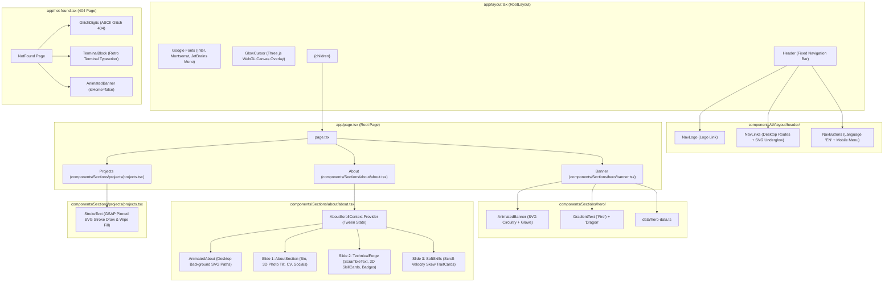

# Project Understanding: Fire Dragon Portfolio

> **Document Version:** 1.0.0  
> **Repository:** `Mohamed-Khonany/fire-dragon`  
> **Branch Analyzed:** `new-version-v2`  
> **Analysis Date:** October 2026  
> **Author:** Senior Engineering Onboarding Analysis  

---

## 1. Overview

### Purpose & Goals
**Fire Dragon** is the personal brand and developer portfolio website for **Mohamed Khonany** (Mohamed Samir Khonany), a frontend and mobile developer based in Cairo, Egypt. He is a 2024 Computer Science graduate from Cairo University specializing in React, Next.js, and React Native.

The primary goals of the project are:
1. **Showcase Professional Identity & Brand:** Establish the "Fire Dragon" brand with a distinctive visual identity based on dark mode surfaces, ember-orange/gold neon accents (`#ff5a00`, `#cd9c01`), and dragon/fire aesthetic themes.
2. **Demonstrate High-End Engineering Capabilities:** Stand out beyond standard portfolio templates by demonstrating advanced frontend capabilities:
   - Custom WebGL / Three.js GLSL fragment shaders (interactive glow cursor trail with noise and falloff physics).
   - GSAP ScrollTrigger timeline orchestration (responsive desktop horizontal pinning, velocity skews, 3D card tilt with specular glare, and text scrambling).
   - Custom SVG glowing circuit path animations with pure CSS keyframes.
3. **Showcase Skills & Experience:** Present technical skills with animated proficiency meters, soft skills traits, professional bio, resume download, and project previews.

### Target Users
- **Tech Recruiters & Talent Acquisition Managers:** Looking to evaluate Mohamed's background, years of experience, and resume (`/Mohamed-Samir-Khonany.pdf`).
- **Engineering Leads & Hiring Managers:** Evaluating frontend and mobile engineering mastery, code architecture, animation finesse, and UI polish.
- **Prospective Freelance / System Clients:** Reviewing past work and contacting via LinkedIn, GitHub, Gmail, or WhatsApp.

---

## 2. Tech Stack

| Layer / Concern | Technology | Version | Purpose in Codebase |
| :--- | :--- | :--- | :--- |
| **Framework** | [Next.js](https://nextjs.org/) | `16.2.9` | React App Router framework, SSR/client boundaries, font loading, static asset serving |
| **Runtime / UI Library** | [React](https://react.dev/) / [React DOM](https://react.dev/) | `19.2.4` | Modern React with React 19 APIs (`useId`, `useSyncExternalStore`, React Compiler compatibility) |
| **Language** | [TypeScript](https://www.typescriptlang.org/) | `^5` | Static type safety (`tsconfig.json`, `strict: true`, ES2017 target) |
| **Styling** | [Tailwind CSS](https://tailwindcss.com/) | `^4.0.0` | Utility CSS using Tailwind v4 `@theme` directive in CSS |
| **CSS Post-Processing** | `@tailwindcss/postcss` | `^4.0.0` | PostCSS plugin for Tailwind CSS v4 compilation |
| **3D & WebGL Graphics** | [Three.js](https://threejs.org/) | `^0.186.1` | Renders the full-screen canvas for the custom GLSL glow trail cursor in [glowCursor.tsx](file:///e:/Fire_Dragon/fire-dragon/components/UI/glowCursor/glowCursor.tsx) |
| **Type Definitions** | `@types/three` | `^0.186.0` | TypeScript definitions for Three.js objects |
| **Animation Engine** | [GSAP (GreenSock)](https://gsap.com/) | `^3.15.0` | Powers timeline animations, ScrollTrigger pins, quickSetter physics, and ScrambleTextPlugin |
| **React GSAP Bridge** | `@gsap/react` | `^2.1.2` | Context-safe hook `useGSAP` for cleanup and scope isolation |
| **Animation (Secondary)** | [Framer Motion](https://www.framer.com/motion/) | `^12.42.2` | Installed dependency (majority of motion logic currently uses GSAP) |
| **Icons (Core)** | [Lucide React](https://lucide.dev/) | `^1.21.0` | System and trait icons (`Globe`, `Menu`, `Search`, `Lightbulb`, `Terminal`, `Flame`, etc.) |
| **Icons (Brands & Tech)** | [React Icons](https://react-icons.github.io/react-icons/) | `^5.6.0` | Social and tech brand icons (`SiJavascript`, `SiReact`, `FaLinkedinIn`, `FaGithub`, `MdMailOutline`) |
| **Fonts** | `next/font/google` | Built-in | Google Fonts: `Inter` (body), `Montserrat` (headings), `JetBrains Mono` (code/terminal) |
| **Linting** | [ESLint](https://eslint.org/) | `^9` | Flat configuration (`eslint.config.mjs`) with `eslint-config-next` (`16.2.9`) |

---

## 3. Project Structure

```
fire-dragon/
├── .git/                                   # Git version control metadata
├── .gitignore                              # Git exclusion rules (node_modules, .next, .env, etc.)
├── AGENTS.md                               # Project-specific AI agent guidelines & Next.js warnings
├── CLAUDE.md                               # Claude configuration pointer (@AGENTS.md)
├── README.md                               # Default create-next-app documentation
├── eslint.config.mjs                       # Flat ESLint configuration with Next.js core vitals & TS rules
├── next.config.ts                          # Next.js configuration object (currently default empty)
├── next-env.d.ts                           # Next.js TypeScript declarations & ambient route types
├── package.json                            # Node dependencies, scripts (dev, build, start, lint)
├── package-lock.json                       # Exact dependency lockfile
├── postcss.config.mjs                      # PostCSS config registering @tailwindcss/postcss
├── tsconfig.json                           # TypeScript compiler configuration (strict mode, @/* alias)
│
├── app/                                    # Next.js App Router root
│   ├── favicon.ico                         # Application browser favicon
│   ├── globals.css                         # Global CSS entrypoint importing Tailwind & theme styles
│   ├── layout.tsx                          # RootLayout: Google fonts, GlowCursor canvas, Header, metadata
│   ├── not-found.tsx                       # Custom 404 error page with glitch effect & interactive terminal
│   └── page.tsx                            # Primary single-page entry assembling Banner, About, Projects
│
├── components/                             # React UI component library
│   ├── Sections/                           # Top-level page sections
│   │   ├── hero/                           # Hero / landing fold
│   │   │   └── banner.tsx                  # Banner section with brand title, bio, and AnimatedBanner
│   │   ├── about/                          # About & experience section
│   │   │   ├── about.tsx                   # Master About container with GSAP horizontal pin controller
│   │   │   ├── aboutScroll.ts              # Shared React context & SSR-safe useMediaQuery hook for GSAP
│   │   │   ├── aboutHero/                  # Bio sub-section
│   │   │   │   └── aboutsection.tsx        # Profile photo, 3D tilt, experience counter, CV button, socials
│   │   │   ├── technicalForege/            # Technical skills sub-section (folder spelled technicalForege)
│   │   │   │   ├── categories.tsx          # Categorized skills dataset (Languages, Frontend, Mobile, etc.)
│   │   │   │   ├── skillBadge.tsx          # SVG animated circular/square progress badge per skill
│   │   │   │   ├── skillCard.tsx           # 3D interactive card housing skill badges with glare
│   │   │   │   └── technicalForge.tsx      # Skills grid with GSAP ScrambleText snake effect on header
│   │   │   └── softSkills/                 # Professional traits sub-section
│   │   │       ├── softSkills.tsx          # Grid container with vertical rotated heading
│   │   │       └── TraitCart.tsx           # TraitCard with ScrollTrigger scroll-velocity skew physics
│   │   └── projects/                       # Projects showcase section
│   │       ├── projectHero.tsx             # Draft showcase cards for Flash Store & Pe2pia (unrendered)
│   │       └── projects.tsx                # Active projects section hosting the pinned StrokeText
│   │
│   └── UI/                                 # Reusable primitives, animations, and layout chrome
│       ├── animated-path/                  # SVG circuitry and cyber neon animations
│       │   ├── animated-path.css           # CSS variables & keyframes (dash, light pulses, fire lines)
│       │   ├── animated-path.tsx           # SVG <Path> and <Line> wrappers with dual background/glow paths
│       │   ├── animated-banner.tsx         # Complex circuit board SVG overlay around the hero logo
│       │   ├── animated-about.tsx          # Pinned SVG background circuitry paths for desktop About
│       ├── fireSpan/                       # Gradient text and glowing elements
│       │   ├── fire.tsx                    # FireSpan inline gradient text & FireDev magnetic button
│       │   └── gradientText.tsx            # GSAP-driven looping gradient text with optional border
│       ├── glowCursor/                     # WebGL cursor effect
│       │   └── glowCursor.tsx              # Three.js + custom GLSL fragment shader trailing ember cursor
│       ├── layout/                         # Site navigation chrome
│       │   ├── header/                     # Sticky responsive navigation header
│       │   │   ├── header.tsx              # Header container with window scroll detection & fade triggers
│       │   │   ├── navlogo.tsx             # Brand logo link to home (/)
│       │   │   ├── navlinks.tsx            # Navigation links with active SVG underglow indicators
│       │   │   └── navbuttons.tsx          # Language toggle (EN), mobile hamburger menu icon
│       │   └── footer/                     # Site footer
│       │       └── footer.tsx              # Empty placeholder file (0 bytes)
│       ├── LightboxModal/                  # Media modal
│       │   └── LightboxModal.tsx           # Click-outside image modal (currently unreferenced / orphaned)
│       ├── not-found/                      # 404 page interactive components
│       │   ├── glitchDigits.tsx            # Randomized ASCII glitch hook and multi-layer 404 display
│       │   └── terminalBlock.tsx           # Retro hacker terminal with typewriter lines & scanline
│       └── stroke-Text/                    # Pinned SVG text animations
│           └── stokeText.tsx               # (spelled stokeText.tsx) Pinned SVG stroke-draw & wipe fill
│
├── data/                                   # Static application datasets
│   ├── about.ts                            # Bio, title, location, socials, CV link, soft skills references
│   └── hero-data.ts                        # Hero first name, last name, description, and logo path
│
├── styles/                                 # Modular CSS stylesheets
│   ├── animations.css                      # Global keyframes (dragon-flow, termBlink, forgeFadeUp)
│   ├── theme.css                           # Tailwind v4 @theme design tokens (colors, radii, spacing)
│   └── typography.css                      # Tailwind v4 @theme font families and font scale definitions
│
└── public/                                 # Static assets served from web root
    ├── favicon.ico                         # Favicon
    ├── file.svg, globe.svg, etc.           # Default template SVGs
    ├── Mohamed-Samir-Khonany.pdf           # Mohamed Samir Khonany's downloadable resume
    └── assets/images/                      # Portfolio imagery
        ├── profilePhoto.png                # Mohamed Khonany portrait
        ├── buildup/ (1.webp .. 6.webp)     # BuildUp project screenshots
        ├── studbook/ (1.webp .. 5.webp)    # StudBook project screenshots
        ├── certificate/                    # ICPC, SAHL, Udemy ICDL certificates
        ├── languageSkills/                 # SVG logos (androidStudio, figma, java, nativeBase, etc.)
        ├── logo/                           # Brand logos (logo.png, logo-banner.png, buildup, studbook)
        ├── pe2pia/                         # Pe2pia SVG asset
        └── projects/                       # FlashStore.png, Pe2pia.png
```

---

## 4. Architecture

### Component Hierarchy & System Composition



### Architectural Key Characteristics
1. **Hybrid SSR / Client Architecture:**
   - [app/layout.tsx](file:///e:/Fire_Dragon/fire-dragon/app/layout.tsx) and [app/page.tsx](file:///e:/Fire_Dragon/fire-dragon/app/page.tsx) serve as Server Components that inject fonts and compose the structural DOM.
   - All interactive UI and animated components explicitly use `"use client"` directives to attach event listeners, GSAP tickers, and WebGL contexts.
2. **Context-Driven GSAP Horizontal Pinning:**
   - In [components/Sections/about/about.tsx](file:///e:/Fire_Dragon/fire-dragon/components/Sections/about/about.tsx), GSAP registers a pinned `ScrollTrigger` on screen widths `>= 1024px`. The horizontal tween (`gsap.to(track, { x: -scrollDistance })`) is published via `AboutScrollContext` ([aboutScroll.ts](file:///e:/Fire_Dragon/fire-dragon/components/Sections/about/aboutScroll.ts)) to child components so internal scroll triggers can sync with horizontal translation.
   - On screens `< 1024px`, the layout smoothly converts to pure vertical CSS block flow without any GSAP pins.
3. **Decoupled Data Layer:**
   - Content strings, social links, resume links, and skill lists are segregated into [data/about.ts](file:///e:/Fire_Dragon/fire-dragon/data/about.ts), [data/hero-data.ts](file:///e:/Fire_Dragon/fire-dragon/data/hero-data.ts), and [categories.tsx](file:///e:/Fire_Dragon/fire-dragon/components/Sections/about/technicalForege/categories.tsx).

---

## 5. Core Features & Logic

### 1. WebGL Custom GLSL Shader Glow Cursor
- **Location:** [components/UI/glowCursor/glowCursor.tsx](file:///e:/Fire_Dragon/fire-dragon/components/UI/glowCursor/glowCursor.tsx)
- **Logic:**
  - Mounts a fixed, click-through HTML `<canvas>` spanning `100vw x 100vh`.
  - Sets up a Three.js `OrthographicCamera`, full-screen triangle geometry, and custom `ShaderMaterial`.
  - Fragment shader computes falloff distance to a 64-point trailing chain updated on every mouse move.
  - **Optimization:** Uniform `uBounds` calculates the minimum bounding box around all active trail points. Any pixel outside `uBounds` is immediately discarded (`discard;`) in the shader, avoiding 63 loop evaluations across millions of screen pixels.
  - **Morphing Dot / Ring:** When hovering interactive DOM elements (`DEFAULT_INTERACTIVE`), the cursor transforms from a glowing gradient dot into an unfilled expanding ring (`ringSize = 70px`) styled with the target element's accent color.
  - Automatically deactivates on mobile/touch (`pointer: coarse`) and reduced motion preferences.

### 2. Desktop Horizontal Pinning & Slide Transition
- **Location:** [components/Sections/about/about.tsx](file:///e:/Fire_Dragon/fire-dragon/components/Sections/about/about.tsx) & [components/Sections/about/aboutScroll.ts](file:///e:/Fire_Dragon/fire-dragon/components/Sections/about/aboutScroll.ts)
- **Logic:**
  - Evaluates `DESKTOP_QUERY = "(min-width: 1024px)"` via SSR-safe `useSyncExternalStore`.
  - Pins the container (`pin: true, start: "top top"`) and translates `trackRef` along the X-axis for `track.scrollWidth - section.clientWidth`.
  - Distributes the horizontal tween via `AboutScrollContext` to nested components.
  - Listens to font and image load events (`document.fonts.ready`, `window.load`) to recalculate `ScrollTrigger.refresh()`.

### 3. Interactive Profile Card with 3D Tilt & Specular Glare
- **Location:** [components/Sections/about/aboutHero/aboutsection.tsx](file:///e:/Fire_Dragon/fire-dragon/components/Sections/about/aboutHero/aboutsection.tsx)
- **Logic:**
  - Uses `gsap.quickTo` for smooth mouse-follow tilt (`rotationX`, `rotationY`, and opposite parallax on the portrait photo and floating badge).
  - Calculates normalized cursor offsets to move a radial-gradient glare hotspot across the card (`--mx`, `--my`) locked to `requestAnimationFrame`.
  - Features an entrance timeline animating letters of Mohamed's name (`.a-name-char`), orbiting rings (`.a-ring-1`, `.a-ring-2`), and an animated experience counter (`.a-count`) counting up to `+02` years.

### 4. Technical Skills Forge with ScrambleText Wave
- **Location:** [components/Sections/about/technicalForege/technicalForge.tsx](file:///e:/Fire_Dragon/fire-dragon/components/Sections/about/technicalForege/technicalForge.tsx), [skillCard.tsx](file:///e:/Fire_Dragon/fire-dragon/components/Sections/about/technicalForege/skillCard.tsx), [skillBadge.tsx](file:///e:/Fire_Dragon/fire-dragon/components/Sections/about/technicalForege/skillBadge.tsx)
- **Logic:**
  - Title characters (`.forge-char`) respond to scroll progress: a Gaussian wave envelope (`SIGMA = 2.2`) travels across the letters. When the wave peak passes a character, GSAP's `ScrambleTextPlugin` temporarily randomizes the glyph with uppercase characters before settling.
  - **Skill Cards:** Group skills into Languages, Frontend, Mobile, Backend, and Tools. Each card supports independent 3D tilt and cursor glare.
  - **Skill Badges:** SVG rounded-square path with `pathLength={100}` and `strokeDashoffset={100 - pct}`. On hover/focus, the path animates clockwise to the skill's proficiency percentage while an animated tooltip reveals the numeric percentage.

### 5. Scroll-Velocity Skew Soft Skills
- **Location:** [components/Sections/about/softSkills/TraitCart.tsx](file:///e:/Fire_Dragon/fire-dragon/components/Sections/about/softSkills/TraitCart.tsx) & [softSkills.tsx](file:///e:/Fire_Dragon/fire-dragon/components/Sections/about/softSkills/softSkills.tsx)
- **Logic:**
  - Intercepts `ScrollTrigger.create({ onUpdate })` and extracts page scroll velocity via `self.getVelocity()`.
  - Converts velocity into dynamic skew (`skewX` on desktop, `skewY` on mobile) and lag offsets (`x`). Cards lean and lag proportionally to scroll speed and spring back to rest when scrolling stops.

### 6. Pinned SVG Stroke Text Draw & Wipe Fill
- **Location:** [components/UI/stroke-Text/stokeText.tsx](file:///e:/Fire_Dragon/fire-dragon/components/UI/stroke-Text/stokeText.tsx)
- **Logic:**
  - Dynamically measures text bounding box using SVG `getBBox()`.
  - Generates SVG `<defs>` with animated `<linearGradient>` and `<clipPath>`.
  - First phase (scroll-scrubbed intro): travels down from top of section to vertical center while animating `strokeDashoffset` from maximum to 0.
  - Second phase: wipes `<rect>` clip-path to fill the text with the ember gradient.
  - Third phase: pins the section for `scrollLength` scrub distance.

### 7. Interactive 404 Hacker Terminal & Glitch Display
- **Location:** [app/not-found.tsx](file:///e:/Fire_Dragon/fire-dragon/app/not-found.tsx), [glitchDigits.tsx](file:///e:/Fire_Dragon/fire-dragon/components/UI/not-found/glitchDigits.tsx), [terminalBlock.tsx](file:///e:/Fire_Dragon/fire-dragon/components/UI/not-found/terminalBlock.tsx)
- **Logic:**
  - Multi-layer glitching 404 numbers with color-offset clip-path layers.
  - Interactive terminal window rendering sequential typewriter lines with animated cursors and moving vertical scanlines. Replays when hovered or clicked to navigate back to `/`.

---

## 6. Data Models / Database

The codebase is entirely static/client-side with no active database, ORM, or persistent backend store. All structured data is modeled via TypeScript interfaces and static objects:

### Key TypeScript Interfaces

```typescript
// From components/Sections/about/technicalForege/categories.tsx
export interface Skill {
  name: string;
  icon: IconType | (() => React.ReactNode);
  color: string;         // Hex brand color (e.g., "#61DAFB")
  percentage?: number;   // 0 to 100 proficiency value
}

export interface Category {
  title: string;
  icon: LucideIcon;
  skills: Skill[];
}

// From components/Sections/about/softSkills/TraitCart.tsx
interface Trait {
  label: string;
  icon: LucideIcon;
}

// From data/about.ts
export interface AboutData {
  name: string;
  description: string;
  title: string;
  location: { city: string; country: string };
  socials: {
    github: string;
    linkedin: string;
    email: string;
    whatsapp: string;
  };
  profilePhoto: StaticImageData;
  yearsOfExperience: string;
  cv: string;
  skills: {
    technical: Category[];
    soft: Array<{ label: string; icon: LucideIcon }>;
  };
}

// From data/hero-data.ts
export interface HeroData {
  firstName: string;
  lastName: string;
  description: string;
  logo: string;
}
```

---

## 7. API / Routes / Interfaces

### Next.js Routes
| Route | Page File | Status | Description |
| :--- | :--- | :--- | :--- |
| `/` | [app/page.tsx](file:///e:/Fire_Dragon/fire-dragon/app/page.tsx) | **Active** | Primary portfolio page containing Banner, About, and Projects sections |
| `/*` (Fallback) | [app/not-found.tsx](file:///e:/Fire_Dragon/fire-dragon/app/not-found.tsx) | **Active** | Custom 404 page with glitch digits, terminal block, and background circuitry |

### Missing Routes Linked in UI
The navigation header ([components/UI/layout/header/navlinks.tsx](file:///e:/Fire_Dragon/fire-dragon/components/UI/layout/header/navlinks.tsx)) contains hardcoded links to:
- `/about`
- `/projects`
- `/work`
- `/contact`

> **Crucial Observation:** None of `/about`, `/projects`, `/work`, or `/contact` exist as directory routes inside `app/`. Clicking these links routes to [app/not-found.tsx](file:///e:/Fire_Dragon/fire-dragon/app/not-found.tsx). Currently, the entire experience is hosted as a single-page layout on `/`.

### External Endpoints & Integrations
- **LinkedIn:** `https://www.linkedin.com/in/mohamed-khonany-5a6659244/`
- **GitHub:** `https://github.com/Mohamed-Khonany`
- **WhatsApp:** Direct link generator: `https://wa.me/201155404878`
- **Email:** Direct client invocation: `mailto:mkhonany777@gmail.com`
- **Resume File:** Direct public asset: `/Mohamed-Samir-Khonany.pdf`

---

## 8. Data & Control Flow

### Complete Page Lifecycle Walkthrough

```mermaid
sequenceDiagram
    autonumber
    actor User as User Browser
    participant NextServer as Next.js Server / CDN
    participant RootLayout as app/layout.tsx
    participant GlowCursor as GlowCursor (Three.js WebGL)
    participant Page as app/page.tsx
    participant GSAP as GSAP & ScrollTrigger

    User->>NextServer: GET /
    NextServer-->>User: Returns HTML + Font Preloads + CSS bundles
    User->>RootLayout: Injects fonts (--font-body, --font-heading, --font-mono)
    RootLayout->>GlowCursor: Initializes Three.js WebGL Canvas Overlay
    Note over GlowCursor: Evaluates pointer media query.<br/>Sets up 64-point mouse follower & GLSL shader.
    RootLayout->>Page: Renders Banner, About, Projects
    Page->>GSAP: useGSAP runs on section components

    alt Screen Width >= 1024px (Desktop)
        GSAP->>GSAP: Pins <About> section at top:top
        GSAP->>GSAP: Binds horizontal translation tween to scroll scrub
        GSAP->>GSAP: Shares tween via AboutScrollContext to TechnicalForge
    else Screen Width < 1024px (Mobile/Tablet)
        GSAP-->>GSAP: Bypasses pinning; natural vertical CSS layout
    end

    User->>User: Scrolls down viewport
    GSAP->>Page: Drives <StrokeText> SVG draw & gradient wipe
    User->>User: Hovers links / buttons
    GlowCursor->>GlowCursor: Morphs pointer into animated expanding ring
```

---

## 9. Configuration & Environment

### Environment Variables
- **Current Status:** No `.env` or `.env.example` files exist.
- **Secrets:** None are required or used. The application is completely static and public.
- `.gitignore` specifies ignore patterns for `.env*`.

### Configuration Files
- **`tsconfig.json`**: Strict TypeScript configuration with path alias `"@/*": ["./*"]` and bundler module resolution.
- **`next.config.ts`**: Standard Next.js configuration object (no custom headers, redirects, or image domain restrictions currently added).
- **`postcss.config.mjs`**: Registers `@tailwindcss/postcss` for Tailwind CSS v4.
- **`styles/theme.css`**: Defines Tailwind v4 tokens:
  - Surface colors: `--color-background: #121414`, container colors (`#1a1c1c` to `#343535`).
  - Primary colors: `--color-primary: #ffb59a`, `--color-primary-container: #ff5a00`.
  - Secondary colors: `--color-secondary: #f5bf34`, `--color-secondary-container: #cd9c01`.
- **`styles/typography.css`**: Defines typography tokens for display and headline scales.

---

## 10. Setup & Run Instructions

### Prerequisites
- Node.js (version 20.x or higher recommended)
- npm, pnpm, yarn, or bun

### Commands
```bash
# 1. Install dependencies
npm install

# 2. Run local development server (starts on http://localhost:3000)
npm run dev

# 3. Type check codebase
npx tsc --noEmit

# 4. Run ESLint code checks
npm run lint

# 5. Build production bundle
npm run build

# 6. Start production server locally
npm run start
```

---

## 11. Testing

### Test Suite Status
- **Current State:** There are **no unit, integration, or end-to-end tests** in the project.
- No testing dependencies (`jest`, `vitest`, `playwright`, `cypress`, `@testing-library/react`) are listed in `package.json`.
- There is no `npm test` script.

### Type Check & Lint Results (Static Verification)
Running `npx tsc --noEmit` and `npm run lint` revealed the following concrete compiler and lint errors:

1. **TypeScript Type Errors in [components/UI/LightboxModal/LightboxModal.tsx](file:///e:/Fire_Dragon/fire-dragon/components/UI/LightboxModal/LightboxModal.tsx):**
   - Line 9: `Property 'contains' does not exist on type 'never'`. Root cause: `useRef(null)` without generic typing causes `modalRef.current` to be inferred as `never`.
   - Lines 15 & 19: `No overload matches this call` on `document.addEventListener("mousedown", handleClickOutside)`. Root cause: `handleClickOutside` destructures its parameter as `({ event }: { event: MouseEvent }) => void`, which does not match the DOM `(ev: MouseEvent) => void` signature.
2. **ESLint Errors (`npm run lint`):**
   - `react-hooks/set-state-in-effect`: Synchronous `setState` calls directly inside `useEffect` bodies in [app/not-found.tsx](file:///e:/Fire_Dragon/fire-dragon/app/not-found.tsx), [glitchDigits.tsx](file:///e:/Fire_Dragon/fire-dragon/components/UI/not-found/glitchDigits.tsx), and [terminalBlock.tsx](file:///e:/Fire_Dragon/fire-dragon/components/UI/not-found/terminalBlock.tsx).
   - `react-hooks/refs`: Modifying `cfgRef.current` directly in render scope in [glowCursor.tsx](file:///e:/Fire_Dragon/fire-dragon/components/UI/glowCursor/glowCursor.tsx#L250).
   - `@typescript-eslint/no-explicit-any`: Parameter typed as `any` in [aboutsection.tsx](file:///e:/Fire_Dragon/fire-dragon/components/Sections/about/aboutHero/aboutsection.tsx#L27).
   - `react/no-unescaped-entities`: Unescaped single quotes in [app/not-found.tsx](file:///e:/Fire_Dragon/fire-dragon/app/not-found.tsx#L80).

---

## 12. Dependencies

| Package | Version | Justification & Usage in Code |
| :--- | :--- | :--- |
| `next` | `16.2.9` | App Router framework, server/client components, Image optimization, Google Fonts |
| `react` & `react-dom` | `19.2.4` | UI foundation |
| `three` | `^0.186.1` | WebGL scene, orthographic camera, shader material, and math vectors for `GlowCursor` |
| `gsap` | `^3.15.0` | Powers timeline animations, ScrollTrigger pins, quickSetter physics, and ScrambleTextPlugin |
| `@gsap/react` | `^2.1.2` | Clean React hook `useGSAP` lifecycle management |
| `lucide-react` | `^1.21.0` | UI system icons across Header, Terminal, Trait cards, and Categories |
| `react-icons` | `^5.6.0` | Social network logos (`FaLinkedinIn`, `FaGithub`) and tech icons (`SiReact`, etc.) |
| `framer-motion` | `^12.42.2` | Motion library (present in dependencies) |
| `tailwindcss` | `^4` | Utility styling engine |
| `@tailwindcss/postcss` | `^4` | Next-gen PostCSS integration for Tailwind CSS v4 |
| `typescript` | `^5` | Strict static typing |

---

## 13. Code Quality Notes

### 1. Inactive & Broken Components
- **[components/UI/LightboxModal/LightboxModal.tsx](file:///e:/Fire_Dragon/fire-dragon/components/UI/LightboxModal/LightboxModal.tsx):** Orphaned component (not imported anywhere). Contains fatal TypeScript errors (`useRef(null)` and invalid event parameter destructuring) that cause `tsc` to fail.
- **[components/UI/layout/footer/footer.tsx](file:///e:/Fire_Dragon/fire-dragon/components/UI/layout/footer/footer.tsx):** Zero-byte empty file. Never imported.
- **[components/Sections/projects/projectHero.tsx](file:///e:/Fire_Dragon/fire-dragon/components/Sections/projects/projectHero.tsx):** Defines a showcase component for `Flash Store` and `Pe2pia`, but is commented out in [components/Sections/projects/projects.tsx](file:///e:/Fire_Dragon/fire-dragon/components/Sections/projects/projects.tsx). Consequently, the project section only renders the animated word "Projects" without displaying project cards.

### 2. Spelling & Naming Inconsistencies
Several folders and filenames contain typos that could lead to path confusion:
- `components/Sections/about/technicalForege/` (misspelling of `technicalForge`).
- `components/Sections/about/softSkills/TraitCart.tsx` (misspelling of `TraitCard.tsx`).
- `components/UI/stroke-Text/stokeText.tsx` (misspelling of `strokeText.tsx`).

### 3. Navigation & Route Disconnects
- In [components/UI/layout/header/navlinks.tsx](file:///e:/Fire_Dragon/fire-dragon/components/UI/layout/header/navlinks.tsx), navigation links point to `/about`, `/projects`, `/work`, `/contact`. None of these pages exist in `app/`, triggering 404 pages.
- In [components/UI/layout/header/navbuttons.tsx](file:///e:/Fire_Dragon/fire-dragon/components/UI/layout/header/navbuttons.tsx), the mobile `<Menu />` hamburger icon has no `onClick` handler or associated drawer component.
- The `EN` language button is non-interactive.

### 4. Data Reference Inconsistencies
- In [data/hero-data.ts](file:///e:/Fire_Dragon/fire-dragon/data/hero-data.ts), line 5 specifies `logo: "../public/assets/images/logo/logo-banner.png"`. Relative filesystem paths like this cannot be used directly in client-side HTML ``. Fortunately, [animated-banner.tsx](file:///e:/Fire_Dragon/fire-dragon/components/UI/animated-path/animated-banner.tsx) bypasses this and imports the image asset directly.

### 5. Unused Code & Cleanliness
- Unused imports exist across multiple files (e.g., `FireSpan` in `banner.tsx`, `softSkills.tsx`, `not-found.tsx`; `GradientText` in `projects.tsx`; `VSCodeIcon` in `categories.tsx`; `alphaOf` in `glowCursor.tsx`).
- Large blocks of commented-out JSX exist in [banner.tsx](file:///e:/Fire_Dragon/fire-dragon/components/Sections/hero/banner.tsx) (call-to-action buttons), [app/not-found.tsx](file:///e:/Fire_Dragon/fire-dragon/app/not-found.tsx) (navigation buttons), and [categories.tsx](file:///e:/Fire_Dragon/fire-dragon/components/Sections/about/technicalForege/categories.tsx) (various skills).

---

## 14. Open Questions

1. **Routing vs Single-Page Scroll Anchors:**
   - Are `/about`, `/projects`, `/work`, and `/contact` intended to be separate routes, or should the navigation links point to hash IDs on the single page (`#about`, `#projects`, etc.)?
2. **Projects Section Status:**
   - Why was `ProjectsSection` commented out in `projects.tsx`? Is there a new design planned for the projects showcase, or should `projectHero.tsx` be updated and re-enabled?
   - In `public/assets/images/`, screenshots exist for `buildup/` and `studbook/`. Are these projects intended to be added alongside `Flash Store` and `Pe2pia`?
3. **Intent for LightboxModal:**
   - Was `LightboxModal` originally intended for inspecting project screenshots or certificates (e.g., `ICPC.png`, `SAHL.png`, `udemy-ICDL.png` in `public/assets/images/certificate/`)?
4. **Mobile Navigation Drawer:**
   - Is there a planned design for the mobile drawer menu when clicking the hamburger icon?
5. **Internationalization (i18n):**
   - Is Arabic localization planned to pair with the `EN` language button?
6. **Footer Component:**
   - What content is intended for the empty `footer.tsx` (e.g., copyright, quick links, contact info)?
